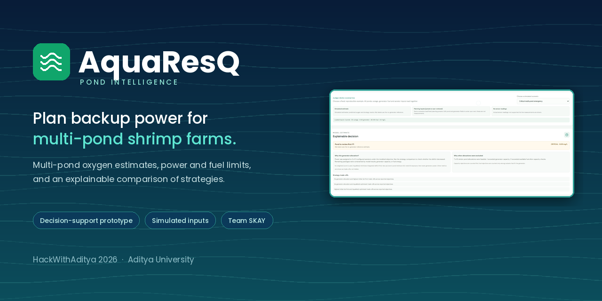
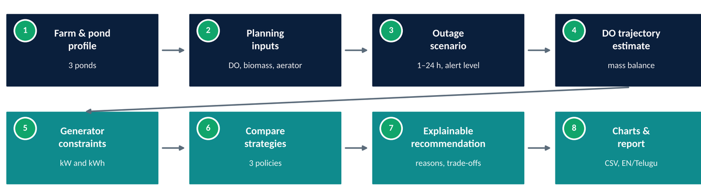
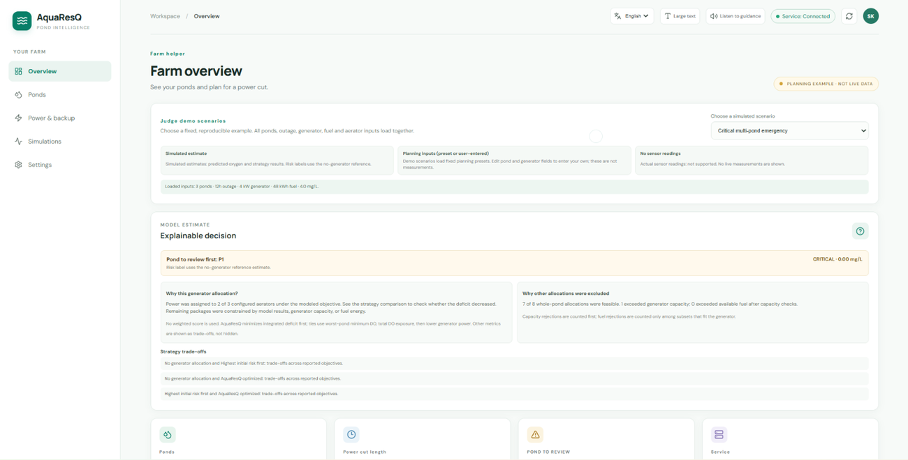
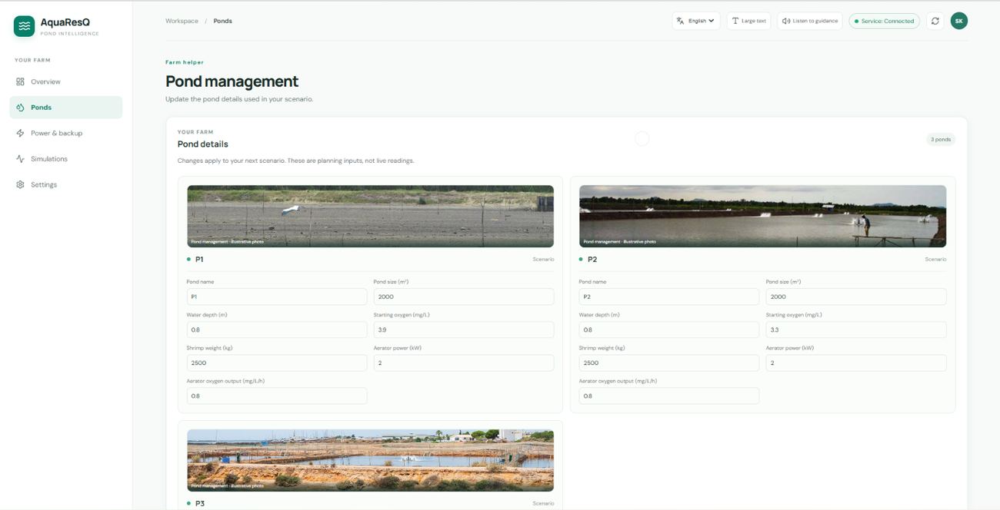
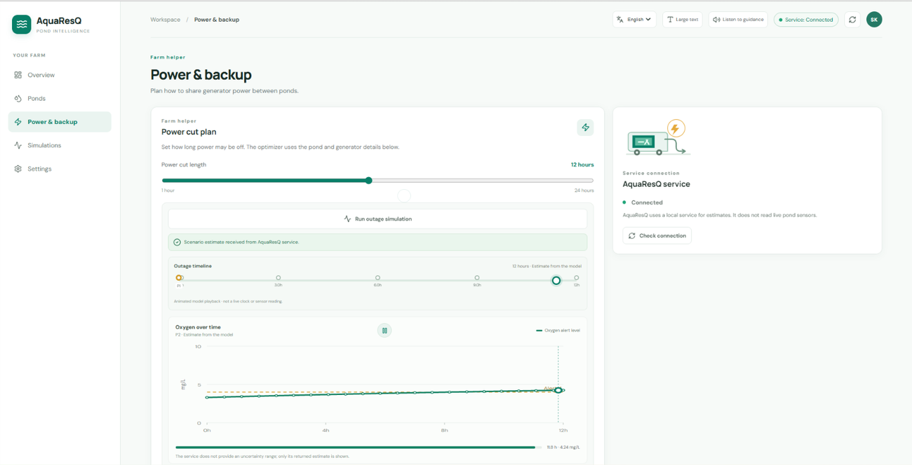
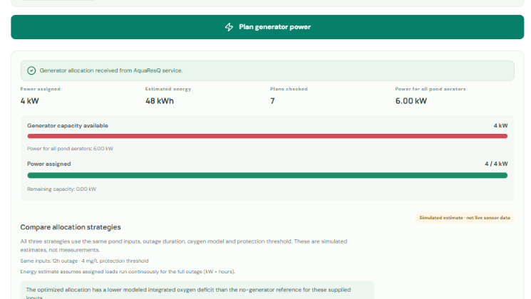
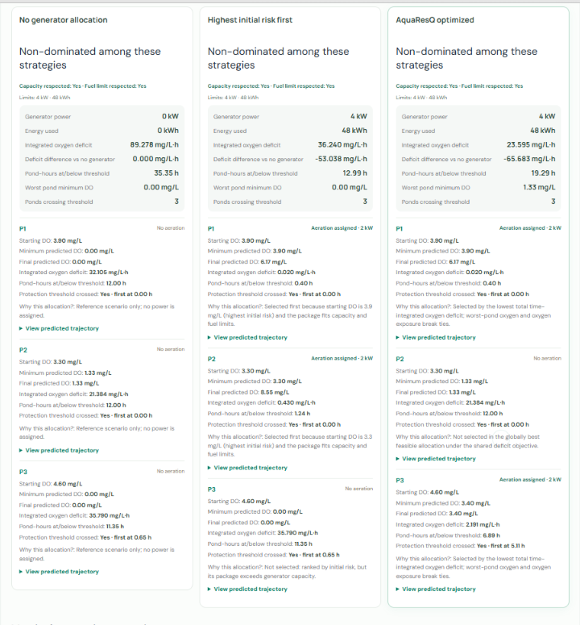
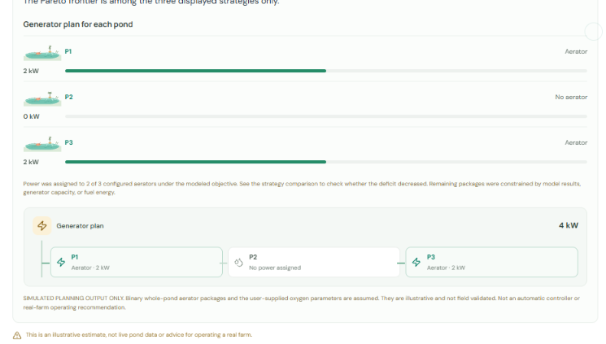
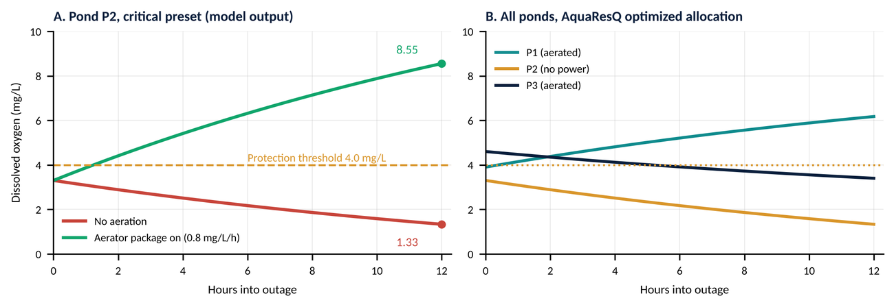
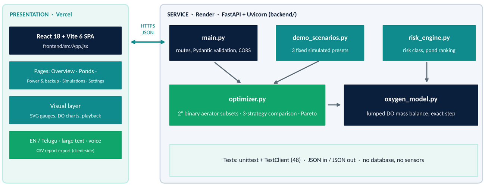

<p align="center">
  
</p>

<h1 align="center">AquaResQ</h1>
<p align="center"><b>Multi-Pond Aquaculture Emergency Intelligence &amp; Resource Optimization System</b></p>

<p align="center">
  <a href="https://aqua-res-q.vercel.app/"></a>
  <a href="https://aquaresq-backend.onrender.com/docs"></a>
</p>
<p align="center">
  
  
  
  
  
  
</p>

<p align="center">
  Team <b>SKAY</b> · <a href="https://hackathon.adityauniversity.in">HackWithAditya 2026</a> · Aditya University · Theme: AgriTech &amp; Aquaculture
</p>

> **Honest scope.** AquaResQ is a software-only **planning and decision-support prototype**. It runs on **simulated and user-entered inputs**. It does **not** read live sensors, does **not** control generators or aerators, does **not** predict mortality, and its parameters are **not field-calibrated**. It does not replace qualified aquaculture expertise.

---

## The problem

Shrimp ponds depend on aerators to keep dissolved oxygen (DO) up, and aerators run on electricity. When power fails and a **limited backup generator** (kW) with **limited fuel** (kWh) cannot run every aerator, a farm with several ponds has to choose which ponds to power. Ponds differ in starting oxygen, depth and shrimp biomass, so the choice is not obvious, and a single-pond oxygen alarm does not show the trade-offs across ponds.

## What AquaResQ does

1. You enter each pond's size, depth, starting oxygen, shrimp weight and aerator details, plus outage length, generator capacity and fuel energy.
2. It **estimates how oxygen changes** in every pond during the outage (documented mass-balance model).
3. It **checks every combination** of aerator allocations against power and fuel limits.
4. It **compares three strategies** on identical inputs and explains the result, including the trade-offs.

<p align="center"></p>

### Features

- Multi-pond planning with editable pond profiles (three ponds in the current UI)
- Outage scenarios from 1 to 24 hours with a configurable oxygen alert level
- Dissolved-oxygen trajectories and a "pond to review first" ranking with reasons
- Exhaustive generator allocation under kW and kWh constraints (2<sup>n</sup> whole-pond aerator subsets)
- Strategy comparison: no generator, highest-initial-risk-first, and AquaResQ-optimized, with Pareto relations and rejected-option counts
- English and Telugu interface, large-text mode, voice guidance, CSV scenario report

## Screenshots

> Planning example with simulated data. Not live pond readings.

| Farm overview | Pond management |
|---|---|
|  |  |

| Power and backup | Generator limits |
|---|---|
|  |  |

| Strategy comparison | Final generator plan |
|---|---|
|  |  |

## Example result (simulated critical scenario)

3 ponds, 12 h outage, 4 kW generator, 48 kWh fuel, 4.0 mg/L protection threshold. Aerator packages need 6 kW in total, so one pond stays unpowered.

| Metric | No generator | Highest initial risk first | **AquaResQ optimized** |
|---|---|---|---|
| Ponds powered | none | P2, P1 | P1, P3 |
| Integrated oxygen deficit (mg/L·h, lower is better) | 89.28 | 36.24 | **23.60** |
| Pond-hours at or below threshold (h, lower is better) | 35.35 | **12.99** | 19.29 |
| Worst-pond minimum DO (mg/L, higher is better) | 0.00 | 0.00 | **1.33** |
| Ponds crossing the threshold | 3 of 3 | 3 of 3 | 3 of 3 |

AquaResQ is **not** claimed to win on every metric: the risk-first rule has fewer pond-hours below the threshold, and all three strategies are mutually non-dominated. Where strategies tie, the software reports them as equal. These are simulated results, not evidence of real-farm performance.

## Oxygen model

Each pond is treated as one well-mixed volume with constant rates during the outage:

$$\frac{dC}{dt} = P + K\,(C_s - C) + S - Q_w - Q_s - Q_r$$

| Symbol | Meaning |
|---|---|
| C, C<sub>s</sub> | dissolved oxygen, saturation DO (mg/L) |
| P | photosynthetic input (mg/L/h) |
| K | natural reaeration coefficient (1/h) |
| S | mechanical aeration, only when the pond's package is powered (mg/L/h) |
| Q<sub>w</sub>, Q<sub>s</sub> | water-column and sediment oxygen demand (mg/L/h) |
| Q<sub>r</sub> | shrimp respiration, from biomass and pond volume (mg/L/h) |

The code applies the exact solution of this linear equation at each step. Parameter defaults are illustrative placeholders, not field-calibrated values. See [`MODEL_ASSUMPTIONS.md`](aquaresq_starter/aquaresq/MODEL_ASSUMPTIONS.md), [`MODEL_LIMITATIONS.md`](aquaresq_starter/aquaresq/MODEL_LIMITATIONS.md) and [`SCIENTIFIC_AUDIT.md`](aquaresq_starter/aquaresq/SCIENTIFIC_AUDIT.md).

<p align="center"></p>

## Architecture

<p align="center"></p>

| Layer | Technology |
|---|---|
| Front end | React 18, Vite 6, JavaScript, CSS, Lucide icons (deployed on Vercel) |
| Back end | Python, FastAPI, Pydantic v2, Uvicorn (deployed on Render) |
| Model | Pure Python: oxygen mass balance, exhaustive subset search, Pareto comparison |
| Tests | `unittest` with FastAPI `TestClient`; Node.js test runner |

There is no database and no sensor interface. Scenario state lives in the browser.

### API

| Method | Endpoint | Purpose |
|---|---|---|
| GET | `/`, `/health` | Service info and health check |
| GET | `/demo-scenarios` | List the three preset scenarios |
| POST | `/demo-scenarios/{id}/run` | Run a preset (simulate + optimize) |
| POST | `/simulate` | Oxygen trajectories and risk ranking |
| POST | `/optimize` | Generator allocation and three-strategy comparison |

Interactive docs: [`/docs`](https://aquaresq-backend.onrender.com/docs). More examples in [`README_API.md`](aquaresq_starter/aquaresq/backend/README_API.md).

## Run it locally

Requirements: Python 3.10+ and Node.js 18+.

```bash
git clone https://github.com/rohitbandi0311-afk/AquaResQ.git
cd AquaResQ/aquaresq_starter/aquaresq

# Backend (terminal 1)
python -m pip install -r backend/requirements.txt
cd backend
python -m uvicorn main:app --reload --host 127.0.0.1 --port 8000

# Frontend (terminal 2)
cd frontend
npm ci
npm run dev
```

Open <http://127.0.0.1:5173/>. The API health check is at <http://127.0.0.1:8000/health>. Deployment settings (Render and Vercel, `CORS_ORIGINS`, `VITE_API_BASE_URL`) are described in the [detailed project README](aquaresq_starter/aquaresq/README.md).

### Tests

```bash
cd aquaresq_starter/aquaresq/backend
python -m unittest discover -v          # 48 tests

cd ../frontend
node --test src/simulationPayload.test.js   # 3 tests
```

All of the above passed when last run on 12 November 2026. Tests show the software behaves as specified in synthetic scenarios; they do not validate the oxygen estimates against real ponds.

## Project structure

```
aquaresq_starter/aquaresq/
├── backend/        FastAPI app, oxygen model, optimizer, risk engine, demo scenarios, tests
├── frontend/       React + Vite interface (English / Telugu)
├── render.yaml     Render deployment blueprint
└── *.md            Model assumptions, limitations, scientific audit, setup notes
```

## Limitations

- No live sensor integration and no direct generator or aerator control
- No farm-specific calibration; model parameters are illustrative
- No validated mortality or survival prediction, and no guarantee of avoided losses
- Estimates depend on user-entered inputs and stated assumptions
- The optimizer is exact but exponential in pond count, so it suits small farms
- Needs expert review and field validation before any operational use

## Roadmap (future scope, not current features)

- [ ] Live dissolved-oxygen sensor input
- [ ] Weather and environmental data
- [ ] Farm-specific calibration with real pond data
- [ ] Uncertainty estimates
- [ ] Mobile emergency alerts and historical outage analysis
- [ ] More advanced optimization (partial loads, scheduling)
- [ ] Field testing with aquaculture experts and shrimp farmers

## Team

**Team SKAY**: 5 members. Team leader: **Bandi Rohith**. Built for HackWithAditya 2026 (Level 1), Aditya University.

## References

- MPEDA, [Better Management Practices](https://mpeda.gov.in/?page_id=728) (shrimp culture, dissolved oxygen guidance)
- Boyd, C. E. and Tucker, C. S. (1998), *Pond Aquaculture Water Quality Management*, Springer. <https://doi.org/10.1007/978-1-4615-5407-3>
- The full project document (with the complete reference list) is submitted with the hackathon entry.

Dashboard photos are illustrative Wikimedia Commons images (CC BY-SA); credits are in [`frontend/public/assets/IMAGE-CREDITS.md`](aquaresq_starter/aquaresq/frontend/public/assets/IMAGE-CREDITS.md).
