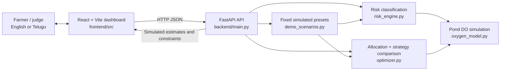

# AquaResQ

### HackWithAditya 2026 · Team SKAY

AquaResQ is a bilingual aquaculture planning prototype for exploring simulated
pond dissolved-oxygen (DO) trajectories and generator allocation during a
power outage. It combines a React dashboard with a FastAPI service, an oxygen
simulation engine, and an exhaustive whole-pond aerator allocation optimizer.

> **Important:** AquaResQ does not connect to live pond sensors. All included
> demo scenarios and model outputs are simulated estimates using illustrative,
> unvalidated parameters. They are not validated farm advice, emergency
> instructions, or evidence of real-world deployment.

## Problem

When power is interrupted, aquaculture operators may need to plan how limited
backup-generator power could be distributed among pond aerators. Comparing
multiple ponds, outage durations, oxygen estimates, and generator constraints
can be difficult in a technical interface.

## Proposed solution

AquaResQ offers a farmer-oriented English/Telugu dashboard for entering pond
and outage planning assumptions, viewing simulated DO estimates, and comparing
generator allocation strategies. The interface presents pond status,
oxygen-over-time charts, generator capacity and estimated energy, and
plain-language decision explanations.

## Objectives

- Make simulated pond oxygen estimates and planning assumptions easier to
  inspect.
- Compare possible whole-pond aerator assignments under generator power and
  optional energy limits.
- Explain the optimizer’s selection and expose differences among strategies.
- Provide a bilingual, responsive interface and reproducible demonstration
  scenarios for a hackathon presentation.

## Features and key innovations

- English and Telugu labels, large-text mode, voice guidance, and visual
  farmer-oriented explanations.
- Pond details, risk labels, oxygen gauges, simulated trajectories, and
  downloadable CSV scenario reports.
- Three fixed simulated demo presets with consistent pond, outage, generator,
  fuel-energy, and aerator inputs.
- Exhaustive search over binary whole-pond aerator packages, subject to
  generator capacity (kW) and optional available energy (kWh).
- A transparent lexicographic optimizer and a Pareto comparison of three
  allocation strategies. Outcomes are not presented as universally better.

These are implementation features only; AquaResQ makes no claim of measured
accuracy, field validation, or deployment on a real farm.

## Architecture



### Data flow

1. The dashboard sends user-entered or fixed demo inputs to the FastAPI
   endpoints.
2. The oxygen model computes sampled DO trajectories from pond geometry,
   supplied demand/oxygen rates, and optional allocated aeration.
3. The risk engine classifies simulated minimum DO against configured
   thresholds.
4. The optimizer enumerates feasible combinations of whole-pond aerator
   packages and evaluates each using the same oxygen model.
5. The API returns simulated results, constraints, and strategy comparisons
   for display and CSV export.

## Technology stack

- **Frontend:** React 18, Vite 6, JavaScript, CSS, Lucide React.
- **Backend:** Python, FastAPI, Pydantic, Uvicorn.
- **Tests:** Python `unittest` with FastAPI `TestClient`; Node.js built-in
  test runner for frontend payload validation.
- **Transport:** JSON over HTTP.

## Installation (Windows PowerShell)

Requirements: Python 3.10+ and Node.js 18+ with npm. From the repository root:

```powershell
py -m venv .venv
.\.venv\Scripts\Activate.ps1
py -m pip install -r backend\requirements.txt
if (-not (Test-Path frontend\.env.local)) {
    Copy-Item frontend\.env.example frontend\.env.local
}
Set-Location frontend
npm ci
Set-Location ..
```

`frontend/.env.local` sets the public frontend API origin. The default is
`http://127.0.0.1:8000`; adjust `VITE_API_BASE_URL` there before starting the
frontend if needed. This is public configuration, not a credential. The
backend CORS allowlist in `backend/main.py` currently permits the local Vite
origins.

## Run locally

Open two PowerShell terminals at the repository root.

**Terminal 1 — FastAPI backend**

```powershell
Set-Location backend
py -m uvicorn main:app --reload --host 127.0.0.1 --port 8000
```

**Terminal 2 — Vite frontend**

```powershell
Set-Location frontend
npm run dev
```

Open <http://127.0.0.1:5173/>. Keep both terminals running. The backend health
endpoint is <http://127.0.0.1:8000/health>.

## Public deployment (Render + Vercel)

Deployment is not performed by this repository setup. Create/configure the
services in your own Render and Vercel accounts, and use the actual service
URLs shown by those platforms.

### Deploy the FastAPI backend to Render

1. Push this project to a Git provider and connect the repository in Render.
2. Create a **Blueprint** from the repository root so Render reads
   [`render.yaml`](./render.yaml).
3. Confirm the service root is `backend`. The Blueprint installs
   `backend/requirements.txt`, starts Uvicorn on Render's `$PORT` bound to
   `0.0.0.0`, and checks `GET /health`.
4. After Vercel has assigned the frontend URL, set the Render service
   environment variable `CORS_ORIGINS` to the exact frontend origin(s),
   comma-separated. Example format only:

   ```text
   https://<your-vercel-project>.vercel.app
   ```

   For a custom domain, list its origin too, such as
   `https://<your-custom-domain>`. Use origins only (scheme + host + optional
   port), with no paths, credentials, or wildcard. Render's dashboard should
   prompt for `CORS_ORIGINS` because the Blueprint marks it `sync: false`.
   Restart/redeploy the backend after setting it.
5. Verify the service's `/health` endpoint responds with status `healthy`.

When `CORS_ORIGINS` is unset, the backend allows only the two local Vite
development origins. Production browser origins must be explicitly configured.
The API enables credentialed CORS, so wildcard origins are rejected.

### Deploy the React/Vite frontend to Vercel

1. Import the same repository into Vercel.
2. Set the project **Root Directory** to `frontend`. Vercel uses
   [`frontend/vercel.json`](./frontend/vercel.json), runs `npm ci` and
   `npm run build`, and serves the `dist` output with an SPA fallback.
3. In Vercel project settings, add the environment variable
   `VITE_API_BASE_URL` with the actual Render API origin, for example:

   ```text
   https://<your-render-service>.onrender.com
   ```

   Do not include an endpoint path such as `/health`. This value is public
   frontend configuration and is embedded in the built JavaScript; never put
   secrets in `VITE_*` variables.
4. Trigger a Vercel deployment after setting the variable. If you change it
   later, rebuild/redeploy the frontend.
5. Add the exact Vercel frontend origin to Render's `CORS_ORIGINS` as
   described above. Vercel preview URLs may have different origins; add only
   exact preview origins you intend to permit.
6. Open the Vercel site, check the API connection, load a simulated demo
   scenario, and confirm the results. CORS must be configured before browser
   requests to the Render API will succeed.

`frontend/.env.example` and `backend/.env.example` contain non-secret local
examples. Do not commit `.env.local` or production credentials. No deployment
URLs are assumed or supplied here.

## API

Interactive API reference (when the backend is running):

- Swagger UI: <http://127.0.0.1:8000/docs>
- OpenAPI JSON: <http://127.0.0.1:8000/openapi.json>
- Endpoint details: [backend/README_API.md](./backend/README_API.md)

| Method | Endpoint | Purpose |
|---|---|---|
| `GET` | `/` | API information and simulation disclaimer |
| `GET` | `/health` | Service health |
| `GET` | `/demo-scenarios` | List the fixed simulated presets |
| `POST` | `/demo-scenarios/{scenario_id}/run` | Run `normal`, `moderate`, or `critical` preset |
| `POST` | `/simulate` | Simulate pond trajectories and risk summaries |
| `POST` | `/optimize` | Allocate generator power and compare strategies |

### Example: simulate two illustrative ponds

This request is a software example only; the inputs are not farm measurements.

```json
{
  "outage_hours": 6,
  "time_step_minutes": 5,
  "alert_threshold_mg_l": 4.0,
  "critical_threshold_mg_l": 3.0,
  "ponds": [
    {
      "pond_id": "DEMO-P1",
      "area_m2": 5000,
      "average_depth_m": 1.2,
      "initial_do_mg_l": 5.2,
      "biomass_kg": 1200
    },
    {
      "pond_id": "DEMO-P2",
      "area_m2": 6500,
      "average_depth_m": 1.3,
      "initial_do_mg_l": 6.0,
      "biomass_kg": 900
    }
  ]
}
```

Send it to `POST http://127.0.0.1:8000/simulate`. Each pond may also specify
water-column demand, sediment demand, shrimp respiration, photosynthesis,
natural reaeration, saturation DO, aerator oxygen output, and aerator package
load. The API enforces positive DO thresholds and requires the critical
threshold to be below the alert threshold.

### Example: optimize generator allocation

The complete, explicitly labelled three-pond simulated request is
[backend/demo_optimizer_request.json](./backend/demo_optimizer_request.json).
It includes a 4 kW generator, 12-hour outage, 4.0 mg/L target, aerator
configurations, and a 48 kWh energy limit. With the backend running, submit
its `request` object from PowerShell:

```powershell
$demo = Get-Content .\backend\demo_optimizer_request.json -Raw | ConvertFrom-Json
$body = $demo.request | ConvertTo-Json -Depth 10
Invoke-RestMethod -Uri http://127.0.0.1:8000/optimize `
  -Method Post -ContentType 'application/json' -Body $body
```

The request and output are simulated planning examples, not real farm data.

## Demo scenarios

On the **Overview** page, use the demo scenario selector:

- **Normal operating conditions** (`normal`)
- **Moderate power outage** (`moderate`)
- **Critical multi-pond emergency** (`critical`)

Each preset supplies reproducible illustrative inputs for three ponds, outage
duration, generator capacity, available energy, and aerator configurations.
Selecting a preset updates the related simulated results together. Identical
inputs and application version are intended to produce identical outputs.

On the **Simulations** page, the separate **Compare 6, 12 and 18 hours**
control runs three outage-duration estimates from the current pond inputs.
These are also simulated estimates, not predictions from live sensors.

## Allocation strategies and comparison

The optimizer evaluates and compares these three strategies using the same
pond inputs, outage duration, protection threshold, oxygen model, and
time-step:

1. **No generator allocation** — reference trajectory with no mechanical
   aeration supplied by backup power.
2. **Highest initial risk first** — greedily considers ponds in ascending
   starting DO order and assigns each whole-pond package when it fits the
   remaining generator capacity and optional energy limit.
3. **AquaResQ optimized** — exhaustively checks feasible binary package
   combinations and selects by the following lexicographic objective:
   - minimize aggregate time-integrated oxygen deficit below the protection
     threshold;
   - maximize the worst pond's minimum DO;
   - maximize total modeled DO exposure;
   - minimize generator power.

The optimizer does not use a weighted sum. Strategy comparisons also report
pond-hours at or below threshold, number of ponds crossing the threshold,
energy use, constraints, per-pond trajectories, and Pareto relations. Pond-hours
and threshold-crossing count are comparison metrics, **not** optimizer
selection criteria; this can lead to trade-offs. A strategy is not claimed to
be universally better.

Estimated energy is calculated as assigned kW multiplied by outage hours,
assuming continuous operation. Available energy is an optional input in kWh;
fuel volume and generator conversion efficiency are not modeled.

## Screenshots

Add current screenshots to `docs/screenshots/` and replace these placeholders
before publication. Do not use simulated results as live sensor displays.

| Screen | Screenshot placeholder |
|---|---|
| Overview and demo scenario selector | `docs/screenshots/overview.png` |
| Pond management and pond details | `docs/screenshots/pond-management.png` |
| Power and generator allocation | `docs/screenshots/power-allocation.png` |
| Oxygen chart and strategy comparison | `docs/screenshots/simulations.png` |
| Telugu interface | `docs/screenshots/telugu.png` |

## Tests and production build

Run backend tests:

```powershell
Set-Location backend
py -m unittest discover
Set-Location ..
```

Run frontend payload tests and create the production build:

```powershell
Set-Location frontend
node --test src/simulationPayload.test.js
npm run build
Set-Location ..
```

## Scientific assumptions and limitations

- No live sensors or sensor readings are supported.
- Demo inputs and model outputs are simulated. Model parameters are
  illustrative and not field-calibrated or independently validated.
- A pond is treated as a well-mixed volume with constant rates during the
  scenario; spatial gradients and changing environmental conditions are not
  represented.
- Mechanical aeration output is an input and is not inferred from electric
  power or measured oxygen transfer.
- Aerator packages are whole-pond binary assignments. Startup, partial loads,
  equipment failures, generator derating, and real fuel-to-energy conversion
  are outside the model.
- Risk thresholds and optimizer objectives are software rules. The application
  does not predict mortality, biological harm, or farm outcomes.

Read the [scientific and technical audit](./SCIENTIFIC_AUDIT.md),
[model assumptions](./MODEL_ASSUMPTIONS.md), and
[model limitations](./MODEL_LIMITATIONS.md). AquaResQ is a demonstration and
must not be used as the sole basis for farm operation or actual emergency
response. Consult local aquaculture and electrical experts and use appropriate
measuring equipment.

## Team and acknowledgements

**Team SKAY** · HackWithAditya 2026

Thanks to the HackWithAditya organizers, open-source maintainers whose
software enables this prototype, and the Wikimedia Commons photographers and
contributors whose illustrative images are used in the dashboard. Image
sources and license details are listed in
[frontend/public/assets/IMAGE-CREDITS.md](./frontend/public/assets/IMAGE-CREDITS.md).

## License

No project license file is currently included. Please confirm the intended
project license before redistributing or accepting external contributions.
