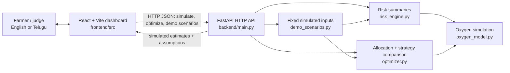

# AquaResQ

AquaResQ is a bilingual aquaculture planning demo for exploring pond dissolved
oxygen estimates and whole-pond generator allocation during a power outage.
Every scenario in this project is **simulated**. The application does not
connect to farm sensors and is not validated for real farm decisions.

## Problem

During a power interruption, farmers may need to decide which pond aerators can
be supplied by limited backup-generator capacity. Technical tools can make it
difficult to compare ponds, constraints, and possible outcomes quickly.

## Proposed solution

AquaResQ provides a farmer-oriented English/Telugu dashboard for entering pond
and outage planning assumptions, viewing simulated oxygen trajectories, and
comparing no-generator, highest-initial-risk-first, and optimizer allocation
strategies. It presents generator capacity and estimated energy constraints
alongside the returned estimates.

## Key innovations

- Pond-level oxygen trajectories and alert/risk summaries.
- Exhaustive binary allocation of configured whole-pond aerator packages under
  generator kW and optional energy kWh constraints.
- A transparent lexicographic optimizer and Pareto comparison with a
  highest-initial-risk baseline.
- Fixed, repeatable demonstration scenarios and a separate editable
  three-pond generator-planning request.
- English and Telugu labels, visual guidance, accessible charts, and
  downloadable scenario reports.

These are software features, not claims of measured accuracy, scientific
validation, or real-farm deployment.

## Architecture



## Technology stack

- **Frontend:** React 18, Vite 6, Lucide React, JavaScript and CSS.
- **Backend:** Python, FastAPI, Pydantic and Uvicorn.
- **Testing:** Python `unittest` / FastAPI `TestClient`; Node.js built-in test
  runner for the frontend payload validation tests.
- **API format:** JSON over HTTP; local development defaults to
  `http://127.0.0.1:8000`.

## Requirements

- Python 3.10 or newer (the backend requirements support current Python
  versions; this project has been tested with Python 3.14).
- Node.js 18 or newer and npm.
- PowerShell commands below are written for Windows. Run equivalent commands
  using your shell if developing on another operating system.

## Installation

From the project root:

```powershell
py -m venv .venv
.\.venv\Scripts\Activate.ps1
py -m pip install -r backend\requirements.txt
if (-not (Test-Path frontend\.env.local)) { Copy-Item frontend\.env.example frontend\.env.local }
Set-Location frontend
npm ci
Set-Location ..
```

## Start the application

Use two terminals from the project root.

**Terminal 1 — backend API**

```powershell
Set-Location backend
py -m uvicorn main:app --reload --host 127.0.0.1 --port 8000
```

**Terminal 2 — frontend**

```powershell
Set-Location frontend
npm run dev
```

Open the frontend at <http://127.0.0.1:5173/>. Keep both terminals running.
The frontend reads its API origin from `VITE_API_BASE_URL` when Vite starts or
builds, defaulting to `http://127.0.0.1:8000`. Set it in
`frontend/.env.local` before starting Vite to use another backend, for example:

```dotenv
VITE_API_BASE_URL=http://192.168.1.20:8000
```

The API origin is public frontend configuration, not a secret. The backend
CORS allowlist in `backend/main.py` must also allow the frontend's origin when
using a non-local host. Vite embeds this value into frontend builds, so rebuild
after changing it.

## API documentation

- Swagger UI: <http://127.0.0.1:8000/docs>
- OpenAPI JSON: <http://127.0.0.1:8000/openapi.json>
- API details and example requests: [backend/README_API.md](./backend/README_API.md)

The main endpoints are:

| Method | Path | Purpose |
|---|---|---|
| `GET` | `/health` | Backend health check |
| `GET` | `/demo-scenarios` | List fixed simulated scenarios |
| `POST` | `/demo-scenarios/{scenario_id}/run` | Run `normal`, `moderate`, or `critical` |
| `POST` | `/simulate` | Simulate pond oxygen and risk summaries |
| `POST` | `/optimize` | Compare generator allocation strategies |

## Reproducible demo scenarios

In the dashboard, open **Simulations** and select **Normal operating
conditions**, **Moderate power outage**, or **Critical multi-pond emergency**.
The backend returns fixed illustrative inputs for all three ponds, the outage,
generator capacity, available energy, and aerator packages. Identical scenario
inputs and application version produce identical outputs. All are labelled
**SIMULATED** and do not represent measured farm data.

For a reproducible three-pond allocation request with an editable generator
capacity, use [backend/demo_optimizer_request.json](./backend/demo_optimizer_request.json).
From the project root, with the backend running:

```powershell
$request = Get-Content .\backend\demo_optimizer_request.json -Raw
$demo = $request | ConvertFrom-Json
Invoke-RestMethod -Uri http://127.0.0.1:8000/optimize `
  -Method Post -ContentType 'application/json' `
  -Body ($demo.request | ConvertTo-Json -Depth 10)
```

The sample uses a 12-hour simulated outage, a 4 kW generator, a 4.0 mg/L
protection target, three ponds, and positive illustrative aerator packages.
Edit `generator_capacity_kw` (and, if needed, `available_energy_kwh`) in the
JSON file to compare different planning constraints. Its inputs and returned
oxygen trajectories are simulations, not live readings.

## Tests and production build

Run backend tests from the backend directory:

```powershell
Set-Location backend
py -m unittest discover
Set-Location ..
```

Run frontend payload tests and build from the frontend directory:

```powershell
Set-Location frontend
node --test src/simulationPayload.test.js
npm run build
Set-Location ..
```

## Limitations and assumptions

- There is no live sensor integration, field calibration, or independent
  validation. Outputs are estimates from supplied or illustrative inputs.
- The pond is modeled as a well-mixed volume with constant rates during an
  outage. Spatial gradients and changing weather, temperature, salinity,
  feeding, and equipment behavior are not represented.
- Mechanical aerator oxygen output is configured as an input; it is not
  derived from aerator power or measured transfer efficiency.
- Generator packages are binary and run for the full modeled outage.
  Estimated energy is allocated kW × outage hours; fuel volume and generator
  efficiency are not modeled.
- Recommendation priorities and oxygen thresholds are configurable software
  rules, not biological predictions or mortality forecasts.

Read [MODEL_ASSUMPTIONS.md](./MODEL_ASSUMPTIONS.md),
[MODEL_LIMITATIONS.md](./MODEL_LIMITATIONS.md), and
[SCIENTIFIC_AUDIT.md](./SCIENTIFIC_AUDIT.md) before interpreting model outputs.
Do not use the application as the sole basis for operating a real farm or
responding to an actual emergency; check the pond with appropriate equipment
and consult local aquaculture and electrical experts.

## Hackathon submission checklist

- [ ] Start the backend and frontend using the commands above.
- [ ] Open the dashboard and verify the backend connection.
- [ ] Run each of the three fixed simulated scenarios.
- [ ] Confirm pond profiles, chart, risk labels, allocation constraints, and
  strategy comparison update with the selected scenario.
- [ ] Switch English/Telugu and check the large-text setting.
- [ ] Navigate Overview, Ponds, Power & Backup, Simulations, and Settings.
- [ ] Download a report after running a scenario.
- [ ] Verify desktop and mobile layouts in a browser responsive viewport.
- [ ] Run backend tests, frontend payload tests, and the production build.
- [ ] State clearly in the presentation that all demonstration values are
  simulated and are not sensor readings or scientifically validated results.

For manual GitHub publication commands, see
[GITHUB_SETUP.md](./GITHUB_SETUP.md).
